# Homelab Docker

## Create SOPS and Age 

### Create private key and see public key
age-keygen -o key.txt

mkdir -p ~/.config/sops/age/
mv key.txt ~/.config/sops/age/keys.txt

echo 'export SOPS_AGE_KEY_FILE=$HOME/.config/sops/age/keys.txt' >> ~/.bashrc
source ~/.bashrc

### Read things, for example
sops --input-type dotenv --output-type dotenv secrets/audiomuse.env.sops

### Encryption: 
sops -e --input-type dotenv --output-type dotenv secrets/grafana.env > secrets/grafana.env.sops

## Schematic for main idea

```mermaid
---
config:
  flowchart:
    curve: basis
    htmlLabels: true
    nodeSpacing: 45
    rankSpacing: 65
  theme: dark
---
flowchart LR
    subgraph INTERNET["☁️ INTERNET"]
        direction TB
        Outside(("🌐 Internet"))
    end

    subgraph VPS["🖥️ VPS — PUBLIC EDGE"]
        direction TB
        Nginx_VPS["⚡ NGINX"]
        Wireguard_VPS{{"🔗 WireGuard
            Tunnel"}}
        SSH["🔐 SSH
            Key Authentication"]
        Crowdsec[["🛡️ CrowdSec
            crowdsec-nginx-bouncer
            cs-firewall-bouncer"]]
        
        Nginx_VPS <-. Port 80 .-> Wireguard_VPS
        Nginx_VPS <-- Security monitoring --> Crowdsec
        SSH <-- SSH protection --> Crowdsec
    end

    subgraph FIREWALL["🔥 NETWORK SECURITY"]
        direction TB
        Firewall{{"OPNsense
            Firewall & Routing"}}
    end
    
    subgraph HOMELAB["🏠 HOMELAB — PRIVATE NETWORK"]
        direction TB
        NGINX_Homelab["🔒 NGINX Reverse Proxy
            SSL / TLS Cloudflare"]
        Apps[["🐳 Docker VM 
            Services"]]

        NGINX_Homelab <-- HTTP / HTTPS --> Apps
    end
    
    Outside -. SSH .-> SSH
    Outside -- HTTP / HTTPS --> Nginx_VPS
    Wireguard_VPS <-- Encrypted Tunnel --> Firewall
    Firewall <-- "VLAN30 - 80 / 443" --> NGINX_Homelab
    
    classDef internet fill:#172554,stroke:#3b82f6,color:#bfdbfe,stroke-width:2px
    classDef proxy fill:#164e63,stroke:#06b6d4,color:#cffafe,stroke-width:2px
    classDef security fill:#451a03,stroke:#f59e0b,color:#fde68a,stroke-width:2px
    classDef tunnel fill:#312e81,stroke:#818cf8,color:#e0e7ff,stroke-width:2px
    classDef firewall fill:#7f1d1d,stroke:#ef4444,color:#fecaca,stroke-width:3px
    classDef homelab fill:#064e3b,stroke:#10b981,color:#d1fae5,stroke-width:2px
    classDef apps fill:#3f3f46,stroke:#a1a1aa,color:#f4f4f5,stroke-width:2px

    class Outside internet
    class Nginx_VPS proxy
    class SSH,Crowdsec security
    class Wireguard_VPS tunnel
    class Firewall firewall
    class NGINX_Homelab homelab
    class Apps apps
    
    style INTERNET fill:#0f172a,stroke:#3b82f6,stroke-width:2px,color:#bfdbfe
    style VPS fill:#171717,stroke:#f59e0b,stroke-width:2px,color:#fde68a
    style FIREWALL fill:#1c1917,stroke:#ef4444,stroke-width:2px,color:#fecaca
    style HOMELAB fill:#052e16,stroke:#10b981,stroke-width:2px,color:#d1fae5
```

## Schema for VLANs

``` mermaid
flowchart TB
    FW["OPNsense Firewall"]

    subgraph NETWORK["Homelab Network"]
        direction TB

        V1["VLAN 1 — Untagged
            Fallback / Native VLAN"]

        subgraph INFRA["Infrastructure"]
            V10["`VLAN 10 — Management
                Proxmox UI
                Switch Management
                OPNsense`"]
        end

        subgraph TRUSTED["Trusted Zone"]
            V20["`VLAN 20 — Trusted LAN
             Personal PC
             Trusted WiFi
             Other personal devices`"]
        end

        subgraph SERVERS["Server Zone"]
            V30["`VLAN 30 — Docker / Services
             Portainer
             Forgejo - IaC
             Navidrome
             Immich
             Jellyfin`"]
            V60["`VLAN 60 — CI/CD
            Forgejo CI Runner Untrusted
            DinD`"]
        end

        subgraph DATA["Storage Zone"]
            V40["VLAN 40 — Storage
             TrueNAS"]
        end

        subgraph UNTRUSTED["Untrusted Zone"]
            V50["`VLAN 50 — IoT
            IP Cameras
            Home Assistant`"]
            V70["VLAN 70 — Guests
            Guest WiFi"]
        end
    end

    FW --> V1
    FW --> V10
    FW --> V20
    FW --> V30
    FW --> V40
    FW --> V50
    FW --> V60
    FW --> V70

    classDef management fill:#7c3aed,color:#fff,stroke:#6d28d9
    classDef trusted fill:#2563eb,color:#fff,stroke:#1d4ed8
    classDef server fill:#0891b2,color:#fff,stroke:#0e7490
    classDef storage fill:#0d9488,color:#fff,stroke:#0f766e
    classDef untrusted fill:#d97706,color:#fff,stroke:#b45309
    classDef fallback fill:#64748b,color:#fff,stroke:#475569

    class V10 management
    class V20 trusted
    class V30,V60 server
    class V40 storage
    class V50,V70 untrusted
    class V1 fallback
```

## Firewall for VLANs

| From / To | 10 Mgmt | 20 Trusted | 30 Docker | 40 Storage | 50 IoT | 60 Git CI | 70 Guests | Internet |
|---        |:---:    |:---:       |:---:      |:---:       |:---:   |:---:      |:---:      |:---:     |
| **10 Management** | – | Allow | Allow | Allow | Allow | Allow | Allow | n/a |
| **20 Trusted LAN** | n/a | – | Allow | Allow | Restricted | Deny | n/a | n/a |
| **30 Docker / Services** | Deny | Deny | – | SMB / NFS | n/a | n/a | n/a | n/a |
| **40 Storage** | n/a | n/a | n/a | – | n/a | n/a | n/a | n/a |
| **50 IoT** | Deny | Deny | HA only | Deny | – | n/a | n/a | n/a |
| **60 Git CI** | Deny | Deny | Deny | Deny | Deny | – | n/a | Allow |
| **70 Guests** | Deny | Deny | Deny | Deny | Deny | Deny | – | Allow |

